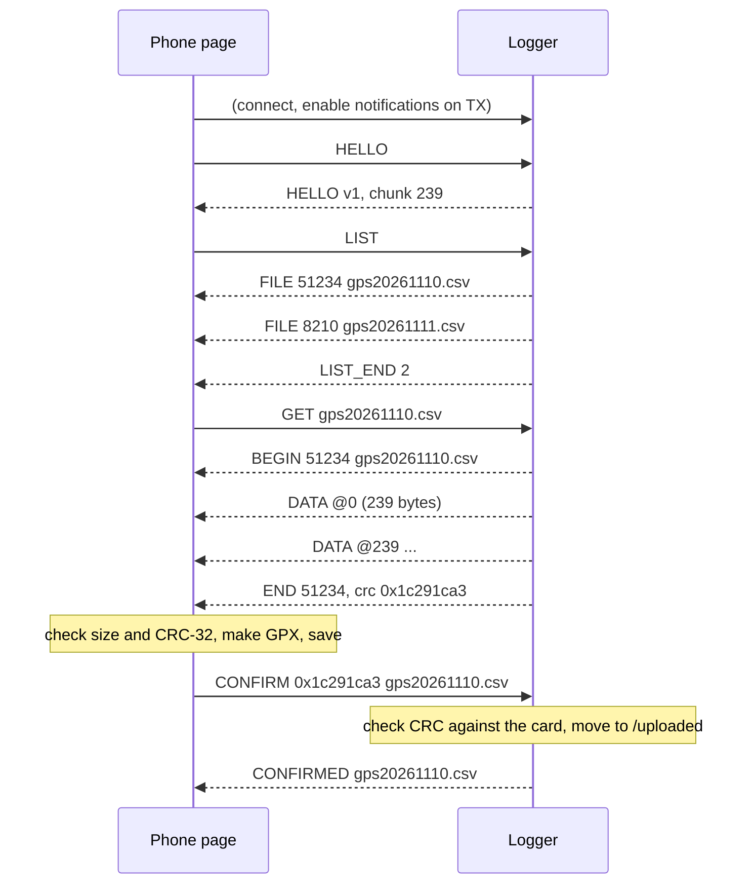

# Bluetooth LE transfer protocol

Version 1. The firmware side is in `src/ble_transfer.cpp` and the phone side is in `web/index.html`.

The logger is a GATT server that advertises only in Transfer mode, as `GPS Logger`. One phone can connect at a time. There is no pairing or bonding, so anyone within range can connect while the switch is on Transfer.

## Service and characteristics

| Role | UUID | Properties |
|---|---|---|
| Service | `1f5f0001-56c8-49fb-9d0c-055269d0a2e3` | Primary, and named in the advertisement so the page can filter on it |
| RX: commands from the phone | `1f5f0002-56c8-49fb-9d0c-055269d0a2e3` | Write, Write Without Response. Up to 96 bytes |
| TX: events and data to the phone | `1f5f0003-56c8-49fb-9d0c-055269d0a2e3` | Notify. Up to 245 bytes |

The advertisement carries the flags and the 128-bit service UUID. The name goes in the scan response, because both together don't fit in 31 bytes.

The logger asks for an ATT MTU of 247. File data goes in chunks of `MTU − 8` bytes, capped at 240: 3 bytes are the ATT header and 5 are the DATA header. With the default MTU of 23 it still works, at 15 bytes per chunk.

## Message format

Every message starts with a one-byte opcode. Integers are unsigned little-endian. Names are ASCII, aren't null-terminated, and run to the end of the message.

### Commands (phone → RX)

| Op | Name | Payload | Reply |
|---|---|---|---|
| `0x01` | HELLO | none | HELLO |
| `0x02` | LIST | none | one FILE per log file, then LIST_END |
| `0x03` | GET | `name` | BEGIN, then DATA, ..., then END |
| `0x04` | CONFIRM | `crc:u32`, `name` | CONFIRMED, or ERROR |
| `0x05` | ABORT | none | none. Stops the file being sent |

### Events (TX → phone)

| Op | Name | Payload |
|---|---|---|
| `0x81` | HELLO | `version:u8` (1), `chunk:u16` (data bytes per DATA message at the current MTU) |
| `0x82` | FILE | `size:u32`, `name` |
| `0x83` | LIST_END | `count:u16` |
| `0x84` | BEGIN | `size:u32`, `name` |
| `0x90` | DATA | `offset:u32`, then file bytes |
| `0x85` | END | `size:u32`, `crc:u32` |
| `0x86` | CONFIRMED | `name` (now in `/uploaded`) |
| `0xEE` | ERROR | `code:u8`, then a short ASCII message |

### Error codes

| Code | Meaning |
|---|---|
| 1 | Unknown command |
| 2 | Bad file name: not `gps*.csv`, or contains a path, `..` or a non-printable character |
| 3 | File not found |
| 4 | Busy: a file is being sent. Only ABORT and CONFIRM for a different file are accepted |
| 5 | SD card not available |
| 6 | Read error while sending, or while checking the CRC |
| 7 | The CRC in CONFIRM doesn't match the file on the card, so the file is kept |
| 8 | Moving the file to `/uploaded` failed, so the file is kept |
| 9 | Message too short |

## Which files

LIST reports root-level files named `gps*.csv`, which means the daily logs (`gpsYYYYMMDD.csv`) plus `gpsnodate.csv` if a catch was made before the GPS knew the date. Files in `/uploaded` and other files aren't listed, and GET and CONFIRM refuse them.

## A transfer

- DATA messages arrive in order, with no gaps. The phone checks that each `offset` equals the bytes received so far.
- The CRC is standard CRC-32, the same as zlib, PNG and Ethernet: reflected, polynomial `0xEDB88320`, initial value and final XOR `0xFFFFFFFF`. The CRC of `The quick brown fox jumps over the lazy dog` is `0x414fa339`.
- The phone sends CONFIRM only after it has checked the CRC and saved the files. The logger checks the CRC again against the file on the card before it moves anything, using the CRC from the send if the file's size hasn't changed since. A file is only ever moved after a confirmed, matching transfer.
- If the phone disconnects mid-file, or sends ABORT, the file stays where it is and nothing is moved.

## Moving to `/uploaded`

On a confirmed transfer, `/<name>` moves to `/uploaded/<name>`.

If `/uploaded/<name>` already exists, the new rows are appended to it without their header line, and `/<name>` is deleted. This happens when the same day was transferred earlier, logging carried on, and then that day was transferred again. `/uploaded` then holds the whole day in one file. The phone's second download only holds the rows logged since the first one, and Chrome saves it as `gpsYYYYMMDD (1).gpx`.

At boot the logger rebuilds today's catch counts and distance from both `/uploaded/gpsYYYYMMDD.csv` and `/gpsYYYYMMDD.csv`, so a transfer during the day doesn't reset them.

## Flow control

The logger sends DATA notifications as fast as NimBLE has buffers, up to 16 each time through the main loop. When NimBLE runs out of buffers, `notify()` returns false and the logger tries the same chunk again on the next pass. A notification that NimBLE has accepted reaches the phone in order, unless the link drops, in which case the transfer fails and is retried from the start. Nothing is acknowledged per chunk, because the CRC at the end covers the whole file.

Expect roughly 5 to 20 KB/s, depending on the phone's connection interval. A full day's log is about 0.5 MB.
