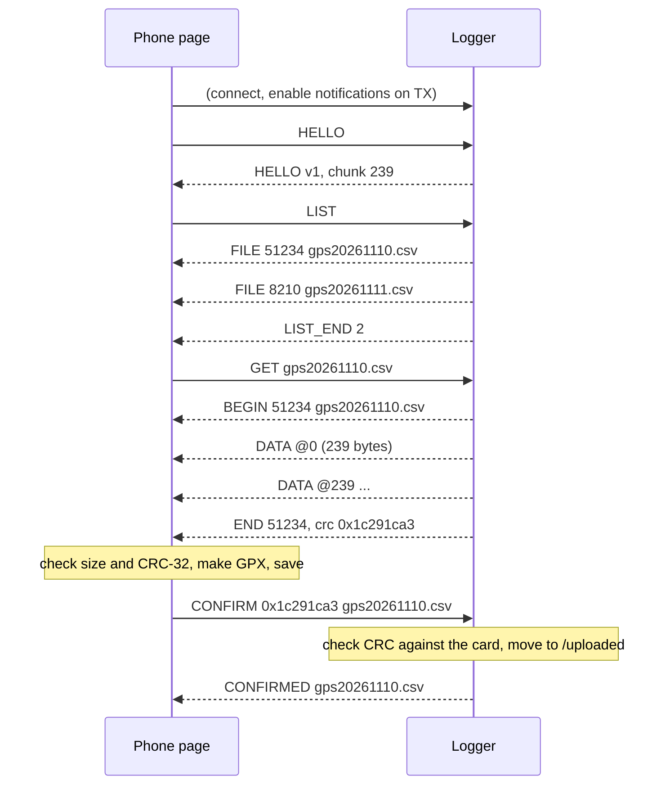
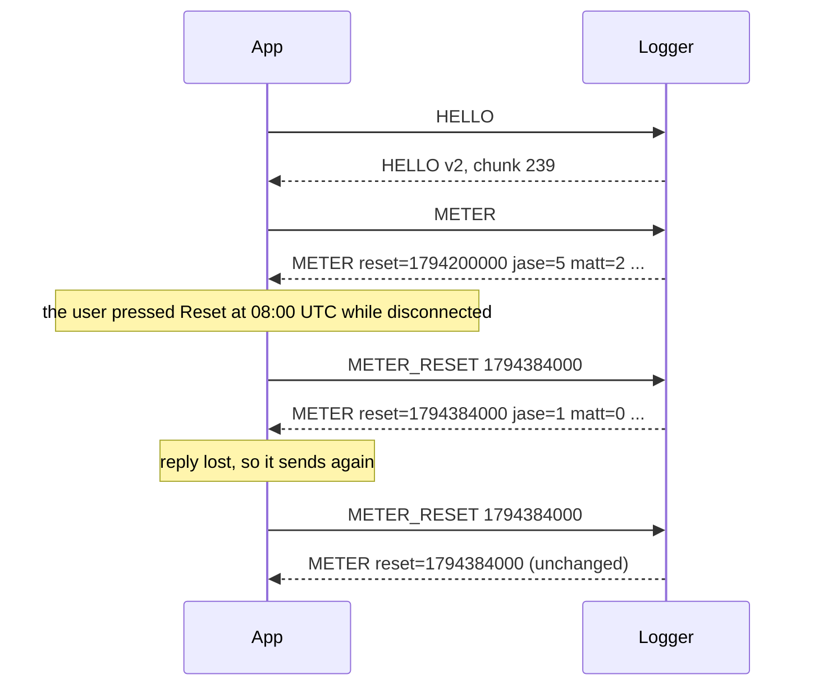

# Bluetooth LE transfer protocol

Version 2. The firmware side is in `src/ble_transfer.cpp`. The phone side is in `web/index.html` (file transfer only) and the Android app in `app/`.

Version 2 adds the trip meter commands (METER, METER_RESET and the METER event). Every version 1 message is unchanged, so a version 1 client works with a version 2 logger. See [Version history](#version-history).

The logger is a GATT server that advertises only in Transfer mode, as `GPS Logger`. One phone can connect at a time. There is no pairing or bonding, so anyone within range can connect while the switch is on Transfer.

## Service and characteristics

| Role | UUID | Properties |
|---|---|---|
| Service | `1f5f0001-56c8-49fb-9d0c-055269d0a2e3` | Primary, and named in the advertisement so the page can filter on it |
| RX: commands from the phone | `1f5f0002-56c8-49fb-9d0c-055269d0a2e3` | Write, Write Without Response. Up to 96 bytes |
| TX: events and data to the phone | `1f5f0003-56c8-49fb-9d0c-055269d0a2e3` | Notify. Up to 245 bytes |

The advertisement carries the flags and the 128-bit service UUID. The name goes in the scan response, because both together don't fit in 31 bytes.

The logger asks for an ATT MTU of 247. File data goes in chunks of `MTU − 8` bytes, capped at 240: 3 bytes are the ATT header and 5 are the DATA header. With the default MTU of 23 it still works, at 15 bytes per chunk.

## Message format

Every message starts with a one-byte opcode. Integers are unsigned little-endian. Names are ASCII, aren't null-terminated, and run to the end of the message.

### Commands (phone → RX)

| Op | Name | Payload | Reply |
|---|---|---|---|
| `0x01` | HELLO | none | HELLO |
| `0x02` | LIST | none | one FILE per log file, then LIST_END |
| `0x03` | GET | `name` | BEGIN, then DATA, ..., then END |
| `0x04` | CONFIRM | `crc:u32`, `name` | CONFIRMED, or ERROR |
| `0x05` | ABORT | none | none. Stops the file being sent |
| `0x06` | METER (v2) | none | METER |
| `0x07` | METER_RESET (v2) | `reset:u32` (UTC seconds since 1970) | METER, or ERROR |

### Events (TX → phone)

| Op | Name | Payload |
|---|---|---|
| `0x81` | HELLO | `version:u8` (2), `chunk:u16` (data bytes per DATA message at the current MTU) |
| `0x82` | FILE | `size:u32`, `name` |
| `0x83` | LIST_END | `count:u16` |
| `0x84` | BEGIN | `size:u32`, `name` |
| `0x90` | DATA | `offset:u32`, then file bytes |
| `0x85` | END | `size:u32`, `crc:u32` |
| `0x86` | CONFIRMED | `name` (now in `/uploaded`) |
| `0x87` | METER (v2) | `reset:u32`, `jase:u16`, `matt:u16`, `distance_m:u32`, `water_s:u32`, `flags:u8`. 18 bytes. See [Trip meter](#trip-meter-v2) |
| `0xEE` | ERROR | `code:u8`, then a short ASCII message |

### Error codes

| Code | Meaning |
|---|---|
| 1 | Unknown command |
| 2 | Bad file name: not `gps*.csv`, or contains a path, `..` or a non-printable character |
| 3 | File not found |
| 4 | Busy: a file is being sent. Only ABORT, METER and CONFIRM for a different file are accepted |
| 5 | SD card not available, or the trip reset couldn't be saved to it |
| 6 | Read error while sending, or while checking the CRC |
| 7 | The CRC in CONFIRM doesn't match the file on the card, so the file is kept |
| 8 | Moving the file to `/uploaded` failed, so the file is kept |
| 9 | Message too short |

## Which files

LIST reports root-level files named `gps*.csv`, which means the daily logs (`gpsYYYYMMDD.csv`) plus `gpsnodate.csv` if a catch was made before the GPS knew the date. Files in `/uploaded` and other files aren't listed, and GET and CONFIRM refuse them.

## A transfer



- DATA messages arrive in order, with no gaps. The phone checks that each `offset` equals the bytes received so far.
- The CRC is standard CRC-32, the same as zlib, PNG and Ethernet: reflected, polynomial `0xEDB88320`, initial value and final XOR `0xFFFFFFFF`. The CRC of `The quick brown fox jumps over the lazy dog` is `0x414fa339`.
- The phone sends CONFIRM only after it has checked the CRC and saved the files. The logger checks the CRC again against the file on the card before it moves anything, using the CRC from the send if the file's size hasn't changed since. A file is only ever moved after a confirmed, matching transfer.
- If the phone disconnects mid-file, or sends ABORT, the file stays where it is and nothing is moved.

## Moving to `/uploaded`

On a confirmed transfer, `/<name>` moves to `/uploaded/<name>`.

If `/uploaded/<name>` already exists, the new rows are appended to it without their header line, and `/<name>` is deleted. This happens when the same day was transferred earlier, logging carried on, and then that day was transferred again. `/uploaded` then holds the whole day in one file. The phone's second download only holds the rows logged since the first one, and Chrome saves it as `gpsYYYYMMDD (1).gpx`.

At boot the logger rebuilds today's catch counts and distance from both `/uploaded/gpsYYYYMMDD.csv` and `/gpsYYYYMMDD.csv`, so a transfer during the day doesn't reset them.

## Trip meter (v2)

The logger keeps a trip meter like a car's. It counts from a reset time until the next reset. Only the app resets it: the device has no reset button. The logger screen shows the meter. All-time totals are the app's job.

### What it counts

From the reset time `reset` (UTC) onwards:

| Field | Meaning |
|---|---|
| `jase`, `matt` | Catch rows whose `time_utc` is at or after `reset` |
| `distance_m` | Metres moved, by the movement rule in [metrics.md](metrics.md) |
| `water_s` | Time on the water in seconds, by the same rule |

Both come from the track rows at or after `reset`, using the movement rule in **[metrics.md](metrics.md)**. The app must use that rule for its own figures. In short: only points with HDOP ≤ 5 count. A move counts once the position has stayed at least max(25 m, 30 m × HDOP) from the last counted position for 30 s. Time on the water runs from each segment's first move to its last, so time at anchor between moves counts. A gap of over 15 minutes between points starts a new segment, and neither the time nor the straight line across the gap counts. That's the same 15-minute rule the phone page uses to split GPX track segments.

So GPS jitter while the logger sits still, on a desk or at the berth, adds nothing to either figure. The first row at or after `reset` starts a segment.

Counts are rebuilt from the log files (see below). So deleting a log file from the card with `rm` removes its rows from the meter at the next rebuild.

### METER_RESET semantics

`METER_RESET reset` means: **the meter counts from time `reset`**. The app supplies the time, and it's the source of truth.

- **Queued resets work.** The app can record a reset while it's disconnected and send it at the next connection. The logger rebuilds the meter from its logs since `reset`, so catches and track logged between `reset` and the moment the command arrives still count. That's the same result as if the reset had arrived instantly.
- **Idempotent.** If `reset` equals the current reset time, nothing changes and the logger just replies with METER. Resending a reset whose reply was lost is safe.
- **Last write wins.** A different `reset`, earlier or later than the current one, replaces it. The app should send only its latest reset.
- `reset = 0` means "never reset": the meter counts every log on the card.
- A `reset` later than the logger's clock is accepted as given. The meter then counts nothing until that time.
- While a file is being sent, METER_RESET gets ERROR 4 (busy). METER always works.

The logger flushes its log buffer, saves `reset` to `/trip.txt`, rebuilds the meter and replies with METER. If the card can't be written, it replies ERROR 5 and the old reset stays in force.

### The METER event

| Offset | Field | Type | Notes |
|---|---|---|---|
| 0 | op | u8 | `0x87` |
| 1 | `reset` | u32 | The reset time in force, UTC seconds. 0 = never reset |
| 5 | `jase` | u16 | Jase's catches since `reset` (stops at 65535) |
| 7 | `matt` | u16 | Matt's catches since `reset` (stops at 65535) |
| 9 | `distance_m` | u32 | Metres, rounded |
| 13 | `water_s` | u32 | Seconds |
| 17 | `flags` | u8 | bit 0: **incomplete**. The card couldn't be read for the last rebuild, so the numbers may be low; the logger retries when the card is back. bit 1: **clock not set**. The logger hasn't had GPS time since boot. Other bits are 0 |

Example: reset 2026-11-11 08:00:00 UTC (`1794384000`), Jase 3, Matt 1, 12 345 m, 3 h 25 min (12 300 s), no flags:

```
87 80 20 f4 6a 03 00 01 00 39 30 00 00 0c 30 00 00 00
```

### Where it's stored and how it's rebuilt

- `/trip.txt` holds `reset_utc=<seconds>` and a comment line. A save writes `/trip.tmp` first and then swaps it in. If power fails mid-swap, the logger reads `/trip.tmp` at the next boot. With no file, `reset` is 0. The console's `rm *` keeps `trip.txt`.
- At boot (before the GPS has the time; the rebuild doesn't need it) and after a reset, the logger reads every `gpsYYYYMMDD.csv` dated on or after the reset's Sydney local date. It reads them in date order, `/uploaded/` part first and then the root folder's, since transferred files move to `/uploaded`. Files dated before the reset's local date can't contain anything after it, because each row goes in the file for its own local date.
- Catch rows with no time (`gpsnodate.csv`, made before the GPS ever had the date) count live but aren't recounted after a restart, because there's no way to tell whether they came after the reset.
- After the rebuild, every point and catch logged updates the meter straight away.
- The rebuild reads every file since the reset. If the meter goes months without a reset, boot takes longer: roughly a second per few MB of logs.

### Example exchange



## Version history

| Version | Change |
|---|---|
| 1 | File transfer: HELLO, LIST, GET, CONFIRM, ABORT |
| 2 | Trip meter: METER (`0x06`), METER_RESET (`0x07`), METER event (`0x87`). Nothing in v1 changed. A client can check `version >= 2` in HELLO before using the meter, since a v1 logger answers METER with ERROR 1 (unknown command) |
| 2 (revised) | `distance_m` and `water_s` now follow the movement rule in [metrics.md](metrics.md) instead of summing every pair of consecutive points, which counted GPS jitter. The message formats didn't change, so the version number didn't either. A logger with the earlier firmware reports the larger, jitter-inflated figures |

## Flow control

The logger sends DATA notifications as fast as NimBLE has buffers, up to 16 each time through the main loop. When NimBLE runs out of buffers, `notify()` returns false and the logger tries the same chunk again on the next pass. A notification that NimBLE has accepted reaches the phone in order, unless the link drops, in which case the transfer fails and is retried from the start. Nothing is acknowledged per chunk, because the CRC at the end covers the whole file.

Expect roughly 5 to 20 KB/s, depending on the phone's connection interval. A full day's log is about 0.5 MB.
