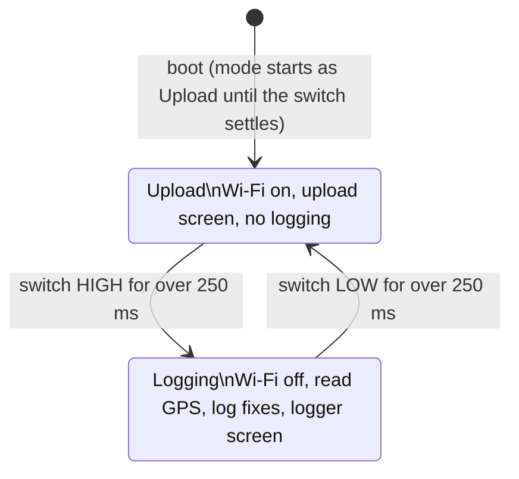

# ESP32 GPS Logger: requirements derived from the code

Status: draft 2, 2026-11-11. Derived from the code, then refined with Jason. Where they disagree, the Decisions section overrides the requirements derived from the code.

## What the device is

A handheld GPS logger built on a Waveshare ESP32-C6 board with a 1.47" LCD. It records a GPS track to an SD card, and two buttons let two people ("Jase" and "Matt") mark the spot where they caught something. A toggle switch moves it between logging and uploading, but uploading was never built on this board.

## Where these requirements came from

| Source | Path | Last changed | State |
|---|---|---|---|
| Copy 1 | `C:\Users\jason\Downloads\ESP32-C6-LCD-1.47-Demo\Arduino\examples\LVGL_Arduino\` | 14 Jan 2026 | Halfway through turning the display into a class. Most of the screen updates are commented out, and so is the LVGL tick timer. |
| Copy 2 | `...\examples\LVGL_Arduino - Copy\LVGL_Arduino_og\` | 16 Jan 2026 | Newest. Display works, plus HDOP filtering, a log file per day, and a serial command console. |
| Older snapshots | `C:\src\esp32\ESP32-C6-LCD-1.47-Demo\Arduino\examples\` | 2 to 14 Jan 2026 | Earlier stages of copies 1 and 2. Nothing in them is missing from the copies above. |
| Uno version | `C:\Users\jason\Documents\Arduino\GpsLogger\` | 2 Jan 2026 | Earlier Arduino Uno R4 WiFi build. I used it only to see what "upload" was meant to do. |

In the requirements below, **[1]** means only copy 1 does it, **[2]** means only copy 2, and **[both]** means both copies do it. Where the two copies disagree, I've used copy 2's behaviour and noted the difference.

## Hardware

| Item | Detail |
|---|---|
| Board | Waveshare ESP32-C6-LCD-1.47 |
| Display | ST7789, 172 × 320, portrait, SPI. MOSI 6, SCLK 7, CS 14, DC 15, RST 21, backlight 22 |
| SD card | On the same SPI bus. CS is GPIO 4 and MISO is GPIO 5 |
| GPS receiver | UART1 at 9600 baud, 8N1. ESP RX is GPIO 19, ESP TX is GPIO 18. Sends NMEA |
| "Jase" button | GPIO 5, active low, internal pull-up |
| "Matt" button | GPIO 4, active low, internal pull-up |
| Mode switch | GPIO 3, internal pull-up. LOW means Upload, HIGH means Logging |
| Libraries | LVGL 8.3.10, SdFat, TinyGPSPlusPlus 0.0.4 (a TinyGPSPlus fork that adds satellite counts, fix quality and fix mode) |

**The buttons share pins with the SD card.** The Matt button and SD CS are both GPIO 4, and the Jase button and SD MISO are both GPIO 5. See D1.

## Functional requirements

### Operating modes

- **FR-1 [both]** A two-position switch picks the mode: Logging or Upload.
- **FR-2 [both]** The switch is debounced. A new position only counts after it has held for more than 250 ms.
- **FR-3 [both]** In Logging mode, Wi-Fi is off and the logger screen is shown.
- **FR-4 [both]** In Upload mode, the device joins a fixed Wi-Fi network and shows the upload screen. Its border is green when connected and red when not.
- **FR-5 [both]** In Upload mode, GPS data isn't read or logged.
- **FR-6 (not built)** In Upload mode, upload the log files. The ESP32 code only has a `// Do upload stuff` placeholder. The Uno version POSTed `gps.log` to an Azure Function (`/api/Upload`) as multipart form data, and recorded uploaded file names in `upload.txt`.

### Reading GPS and accepting a fix

- **FR-7 [both]** Read NMEA from the GPS UART all the time while in Logging mode.
- **FR-8 [both]** A fix is accepted for logging when:
  - the location is valid,
  - its latitude or longitude differs from the last accepted fix (a stationary repeat isn't logged), and
  - **[2]** HDOP is 5 or less. If no HDOP has been received, it's treated as 100. Copy 1 has no HDOP check.
- **FR-9 [2]** "GPS comms OK" means at least one byte arrived from the GPS in the last 1000 ms.
- **FR-10 [2]** "Has lock" means a fix was accepted in the last 5000 ms and the current HDOP is 5 or less.

### Logging to SD

- **FR-11 [both]** Each accepted fix becomes one comma-separated record with these fields:

  | # | Field | Format |
  |---|---|---|
  | 0 | Satellites tracked | integer |
  | 1 | Satellites visible | integer |
  | 2 | HDOP | 1 decimal place |
  | 3 | Latitude | 6 decimal places |
  | 4 | Longitude | 6 decimal places |
  | 5 | Age of the location fix | ms |
  | 6 | Date (UTC) | `MM/DD/YYYY` |
  | 7 | Time (UTC) | `HH:MM:SS`. Copy 1 adds `.cc` (centiseconds) |
  | 8 | Age of the date | ms |
  | 9 | Altitude | metres, 2 decimal places |
  | 10 | Course | degrees, 2 decimal places |
  | 11 | Speed | km/h, 2 decimal places |
  | 12 | Fix quality | integer (GGA quality) |
  | 13 | Fix mode | single character (RMC mode, such as A, D or N) |
  | 14 | Comment | text, such as `Jase catch` |

  Every field, including the last one, ends with a comma. The file has no header row.
- **FR-12 [both]** Records are held in RAM and written to the card 30 at a time.
- **FR-13** Log file name:
  - **[2]** `gpsYYYYMMDD.log`, using the UTC date of the 30th record in the batch. Records are appended.
  - **[1]** `gps.log`, always the same file.
- **FR-14 [both]** Files get their created and modified timestamps from GPS time.
- **FR-15 [both]** At boot, if `readme.txt` is on the card, its contents are printed to the serial port.

### Marking a catch

- **FR-16 [both]** There are two buttons, Jase and Matt. They're active low, debounced for 50 ms, and a press counts once until the button is released.
- **FR-17 [both]** A press is saved until the next accepted fix. That fix's comment is then set to `Jase catch` or `Matt catch`. If both were pressed, Matt wins.
- **FR-18 [both, probably a bug]** The comment is never cleared. Every record after the first press carries the same comment. See D2.

### Logger screen (172 × 320)

From top to bottom:

- **FR-19** Two arc gauges, each 75 px and spanning 270°:
  - **[2]** Left arc: satellites tracked, from 0 to 16. Right arc: HDOP, labelled "HDOP".
  - **[1]** Left arc: tracked. Right arc: visible.
  - Satellite arc colour: green when there's a lock, orange when more than 1 satellite, red otherwise.
  - **[2]** HDOP arc: the value is `1000 − HDOP×10`, so a fuller arc means better accuracy. Colour: green when HDOP is 5 or less, orange when under 50, red otherwise.
- **FR-20 [both]** Course in degrees and as a compass point (such as NE), in a 24 pt font. **[2]** It shows `--` when the course isn't valid or HDOP is over 5.
- **FR-21 [both]** Speed in km/h to 1 decimal place, in 24 pt. It follows the same `--` rule.
- **FR-22 [both]** Date as `DD/MM/YYYY` and time as `HH:MM:SS (UTC)`, in 20 pt, or `--` when they're not valid.
  - The display shows the date day-first, but the log stores it month-first. See D5.
- **FR-23 [both]** Uptime since boot, as `N days, HH : MM : SS`, in 12 pt.
- **FR-24 [both]** A bar showing how many records are waiting to be written, from 0 to 30. It shades from green to red.
- **FR-25 [2]** The screen border is green when GPS comms are OK and red when they're not. Copy 1 also briefly turns it yellow when a fix arrives.
- **FR-26 [2]** Satellites, course and speed refresh at most once a second. Date, time and uptime update on every pass of the main loop.
- **Styling:** grey separator lines, a black rounded container with a 3 px border, and white text.

### Serial console [2]

- **FR-27** USB serial at 115200 baud, taking one command per line:

  | Command | What it does |
  |---|---|
  | `status` | Prints the GPS fix mode |
  | `ls` | Lists files in the card's root folder with their sizes |
  | `cat <file>` | Prints a file |
  | `rm <file>` | Deletes a file and reports whether it worked |
  | `rm *` | Deletes every file in the root folder except `readme.txt` |

- **FR-28 [both]** Debug messages are printed to serial, such as button presses, screen changes, file writes and Wi-Fi attempts.

### Startup [2]

- **FR-29** Print the flash size, then start the LCD, LVGL, SD card and screens. Then start USB serial and wait for it to connect, then start the GPS UART.

## Defects and gaps found in the code

These aren't requirements. Each one needs a decision before the rewrite.

| # | What I found | Effect |
|---|---|---|
| D1 | The buttons share GPIO 4 and 5 with SD CS and MISO. | A Matt press pulls the SD chip select low. SD reads may break or read as button presses. What's actually wired? |
| D2 | The catch comment is never reset (FR-18). | After the first press, every record says "X catch". |
| D3 | Records only reach the card in batches of 30. Switching mode or losing power doesn't trigger a write. | Up to 29 fixes are lost at power-off, and the catch you just marked may be among them. |
| D4 | The file is named by the date of the 30th record, in UTC. | A batch that crosses UTC midnight lands in the next day's file. In Australia, UTC midnight is mid-morning. |
| D5 | The log stores dates as MM/DD/YYYY but the screen shows DD/MM/YYYY. The log has no header row and ends each line with a trailing comma. | The CSV is awkward to import. |
| D6 | Copy 2 waits in `while (!Serial)` at boot. | On the ESP32-C6's USB serial, the logger probably won't start unless a computer is connected. |
| D7 | Wi-Fi connect calls `WiFi.begin()` and checks the status straight away, then does it all again on every loop pass. | The first check always fails, and calling `begin` again may keep restarting the connection. |
| D8 | Upload isn't built (FR-6). | Upload mode only connects to Wi-Fi. |
| D9 | The serial command reader keeps reading until it gets `\n`, with no length limit, and counts "no data" as a character. | A long line or a slow sender overruns the 64-byte buffer. |
| D10 | Date and time show `--` unless the time changed since the last read, and they're redrawn about every 5 ms. | The date and time probably flicker to `--`. |
| D11 | Wi-Fi SSID and password are hard-coded in the sketch. | Secrets end up in the source. The Uno version also hard-codes Azure keys. |
| D12 | Copy 1 has the LVGL tick timer commented out. | Animations and timers in copy 1 probably don't advance. That may be why copy 2 was restarted from the original example. |
| D13 | At boot, the mode starts as Upload until the switch has been read for 250 ms. | Every boot briefly tries to connect to Wi-Fi. |
| D14 | Stationary repeats are dropped (FR-8). | Time spent stopped isn't in the track, and a catch made while stopped is only marked when the boat next moves. |

## Decisions

| # | Question | Decision |
|---|---|---|
| 1 | Use | Fishing. Two buttons, fixed to Jase and Matt in the code. |
| 2 | Catch marking | A press writes a catch record straight away at the current position, even when stationary, and writes it to the card at once. Only that record carries the comment. The screen briefly shows "Jase catch!" or "Matt catch!", and keeps a catch count per person for the day. Assumed: the count is rebuilt from today's log at boot, so it survives a restart. |
| 3 | Upload | Upload goes over Bluetooth LE to an Android phone. The receiver is a web page I'll write, using Web Bluetooth in Chrome on Android. It saves files to the phone's Downloads, and won't work on iPhone. A file that transfers successfully moves to `/uploaded` on the card. Wi-Fi is removed completely, credentials included. The mode switch now chooses between Logging and Transfer (Bluetooth on). Still to settle: where the page is hosted, since Web Bluetooth needs HTTPS (for example GitHub Pages). Note that Bluetooth LE moves roughly 5 to 20 KB/s, so log size matters (Q4, Q6). |
| 4 | Log format | The device writes a tidied CSV: a header row, ISO 8601 UTC time (`2026-11-11T08:15:02Z`), no trailing comma, and the two age fields dropped. The phone page turns it into GPX, with track points plus a waypoint for each catch. Assumed: the page can also save the raw CSV. |
| 5 | Data safety | Buffered track points are written to the card every 10 s. They're also written straight away on a catch, on a mode switch, and on low battery if that can be detected. At most about 10 s of track is lost at power-off. |
| 6 | Log rate | A point is logged when 5 s have passed or the position has moved 10 m, whichever comes first. While stationary, a point is logged every 60 s, which replaces "drop stationary repeats" and fixes D14. That's about 0.5 MB per day. |
| 7 | Accuracy filter | Track points are logged only when HDOP is 5 or less, a fixed value as in copy 2. Speed and course show `--` above that. A catch is always recorded: if the current fix is poor, it uses the last good fix and records how old that fix is. |
| 8 | Time zone | The screen and file names use Sydney/Melbourne local time, switching between AEST and AEDT automatically. Times inside the log stay in UTC (ISO, ending `Z`). Each record goes in the file for its own local date, which fixes D4. |
| 9 | Wiring and power | Not built yet, so I'm choosing the pins. Proposed: Jase button GPIO 1, Matt button GPIO 2, mode switch GPIO 3, all active low to GND with internal pull-ups. GPS stays on RX 19 / TX 18. To check against the Waveshare pinout before wiring. Powered from a USB power bank, so there's no battery-level reading or low-battery write (Q5). Startup must not wait for a computer on USB (D6). |
| 10 | Screens | **Logger screen:** keep the tracked-satellites arc, the HDOP arc, course, speed, local date and time, and the comms border. Remove uptime and the buffer bar. Add catch counts for Jase and Matt, the catch banner (Q2), today's distance travelled (rebuilt from today's log at boot), and a logging status line: OK, SD error or no fix, plus points logged today. **Transfer screen:** shows the Bluetooth state (waiting or connected), the file being sent, a progress bar, and how many files are left. |
| 11 | Serial console | Keep `status`, `ls`, `cat`, `rm <file>` and `rm *`, with input limited to the buffer size (fixes D9). Add `help`, `df` (card space), `tail <file> [n]` and `ls /uploaded`. `rm *` asks for confirmation and still keeps `readme.txt`. |
| 12 | Build setup | A PlatformIO project on LVGL 8, keeping the working ST7789 driver, with pinned library versions and its own `lv_conf.h`. Note: the official PlatformIO ESP32 platform doesn't support the ESP32-C6 with Arduino core 3.x, so this will probably need the community `pioarduino` platform. The project lives in `C:\src\mine\gps-logger` as a local git repo with no remote. |

### Still to settle

- Where the phone transfer page is hosted. Web Bluetooth needs HTTPS, so GitHub Pages or similar.
- Check the proposed button and switch pins (Q9) against the Waveshare pinout.

## Open questions for refinement

1. ~~**Use:**~~ Decided, see Decisions. Is this for fishing, logging the track and where each person caught a fish? Is it always two named people, or should names and button count be settings?
2. ~~**Catch marking:**~~ Decided, see Decisions. Should a press log a separate catch record straight away, even if the position hasn't changed? Should it give feedback such as a screen flash or a counter? Should the screen show a catch count per person?
3. ~~**Upload:**~~ Decided, see Decisions. Is upload still wanted? Where would files go: the Azure Function, a phone over Wi-Fi or Bluetooth, or just taking the SD card out? What should happen to a file after it uploads (delete, move, or record it as uploaded)?
4. ~~**Log format:**~~ Decided, see Decisions. Keep the CSV fields above, or change them? Options include a header row, ISO dates, and dropping the age fields. Or should it write GPX directly? The Uno folder has a `gpx/log.gpx`.
5. ~~**Data safety:**~~ Decided, see Decisions. How many fixes can you afford to lose at power-off? One option is to write every N seconds, or straight away when a catch is marked, and on every mode switch.
6. ~~**Log rate:**~~ Decided, see Decisions. Log every accepted fix (about 1 Hz), or apply a minimum time or distance between points?
7. ~~**Accuracy filter:**~~ Decided, see Decisions. Keep the HDOP ≤ 5 cut-off? Should it be a setting?
8. ~~**Time zone:**~~ Decided, see Decisions. Show local time (AEST/AEDT) on the screen, and name files by local date?
9. ~~**Wiring:**~~ Decided, see Decisions. Which GPIOs are the buttons and switch actually on (D1)? What's the GPS module? Is it on battery, and is a battery-level display wanted?
10. ~~**Screen:**~~ Decided, see Decisions. Keep copy 2's layout (tracked arc plus HDOP arc), or show visible satellites as copy 1 did? Is anything missing, such as lat/lon, distance travelled or the current file name?
11. ~~**Serial console:**~~ Decided, see Decisions. Keep it? Are any more commands wanted, such as `df`, `tail`, or a way to set Wi-Fi details?
12. ~~**Rewrite scope:**~~ Decided, see Decisions. Stay on Arduino IDE and LVGL 8, or move to PlatformIO and/or LVGL 9? Where should the new project live, and should it be a git repo?
